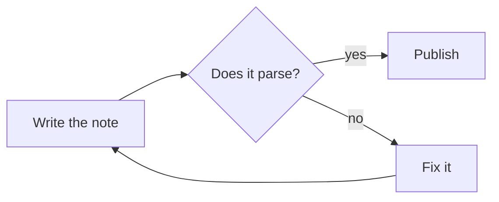
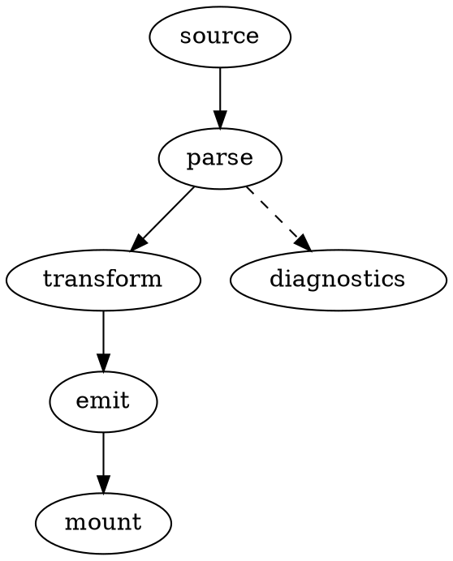
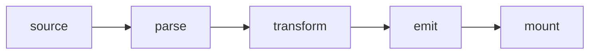
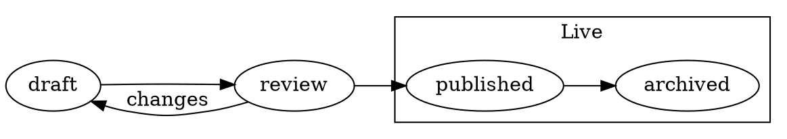

# Diagrams for Luccet

Two add-ons that draw a [Luccet](https://luccet.dev) note's fences as diagrams, each loaded on its own:

- **`mermaid.js`** draws each fence in the language `mermaid` with [Mermaid](https://mermaid.js.org): flowcharts, sequence, class, state and entity–relationship diagrams, Gantt and pie charts, mind maps, timelines, git graphs and the rest of [Mermaid's diagrams](https://mermaid.js.org/intro/syntax-reference.html).
- **`graphviz.js`** draws each fence in the language `dot` or `graphviz` with [Graphviz](https://graphviz.org): graphs in its [DOT language](https://graphviz.org/doc/info/lang.html), laid out by any of its engines (`dot`, `neato`, `fdp`, `circo`, `twopi` …).

Both take the page theme's colours and its sans-serif font, in light, dark and print, and fetch their library only for a note that has a fence for it. [`tools/diagrams.js`](#diagrams-drawn-ahead) draws a built page's diagrams ahead, so that its readers fetch neither.

## Loading them

They need Luccet 2, the [add-on API](https://luccet.dev/docs/addon-api.html) 2 (`luccet.api`). List the one a note uses, or both, in `data-use` on the luccet.js tag:

````html
<!doctype html><meta charset="utf-8"><script src="luccet.js" data-use="https://cdn.luccet.dev/diagrams/v1/mermaid.js https://cdn.luccet.dev/diagrams/v1/graphviz.js"></script>

# Publishing




````

or in a `:::use` block, one entry per line, which must come first in the note (after `:::meta` at most):

```html
<!doctype html><meta charset="utf-8"><script src="luccet.js"></script>

:::use
https://cdn.luccet.dev/themes/v1/nord.css
https://cdn.luccet.dev/diagrams/v1/graphviz.js
:::
```

- **From cdn.luccet.dev,** `v1/` is the newest 1.x release of the kit, checked for a newer one every hour; a release's own folder, such as `v1.0.0/`, never changes, and browsers keep it a year.
- **A copy of your own:** put `mermaid.js` or `graphviz.js` beside your notes and list it by its path, `data-use="graphviz.js"`.
- **Options** go in the add-on's query string, `mermaid.js?look=classic` or `graphviz.js?engine=neato`, or in `window.LUCCET = {use: {mermaid: {…}, graphviz: {…}}}` in a head script ([options](https://luccet.dev/docs/schema.html#use-options)). See [Mermaid options](#mermaid-options) and [Graphviz options](#graphviz-options).

How add-ons load, and how to write one: [Add-ons](https://luccet.dev/docs/schema.html#addons).

## Figures and ids

- **In a figure,** a diagram gets the figure's caption, its number where the vocabulary counts figures, and references ([figures](https://luccet.dev/docs/elements.html#figures)).
- **An id on the fence,** as in ```` ```mermaid {#id} ```` or ```` ```dot {#id} ````, goes to the diagram, so links land on it; a diagram that cannot be drawn gives it back to the fence. The ids inside a drawing (its nodes, markers, styles) are made unique to each placement, so two fences with one source, or a screen and a print copy, never repeat an id.
- **A titled fence** (```` ```mermaid[Title] ````) is a [listing](https://luccet.dev/docs/guide.html#listings), as for code. For a diagram, a figure usually reads better.

````html
:::figure[From source to page]{#fig-pipeline}

:::

@fig-pipeline shows the engine's steps.
````

## Mermaid

### Mermaid colours

The add-on sets Mermaid's `base` theme from the page's [custom properties](https://luccet.dev/docs/schema.html#custom-properties), so every [theme](https://github.com/Luccet/themes) has matching diagrams.

- **Shapes and lines.** Nodes are `--t-soft` with `--t-muted` borders, lines and arrows `--t-muted`, text `--t-fg` on `--t-bg`. Notes are `--t-mark` with a `--t-warn` border, and a critical task in a Gantt chart is `--t-error-bg` with a `--t-error` border.
- **Categories:** pie slices, git branches, mind map and timeline sections, the series of an xy chart. These take the theme's accents in turn: `--t-link`, then the code colours (`--t-code-*`), less any too close to one already taken. Pie slices and branches use the accents themselves; sections use a tint of them, with text in `--t-fg`. The code colours come from a theme, or from the [code add-on](https://github.com/Luccet/code)'s defaults; luccet.css sets none, so with neither the categories alternate between the link colour and the text colour.
- **Light, dark and print.** Mermaid writes the colours into each drawing, so the add-on draws a diagram for the palette in effect, and again when the reader switches between light and dark, or when a page script switches the theme and says so (`luccet:theme`, below). A diagram is drawn a second time in print colours, dark on white, unless its palette is the print palette already; that copy is the one printed, a dark theme's and a light theme's alike.
- **`luccet:theme`.** A page script that switches the theme itself, by replacing the theme's `<link>`, dispatches a `luccet:theme` event on `window` once the new stylesheet applies: `window.dispatchEvent(new Event('luccet:theme'))`. The add-on draws its diagrams again in the new colours. It reads nothing from the event, so a `CustomEvent` with a `detail` works as well.
- **Your own colours:** set the custom properties, or Mermaid's own theme variables, which win: `window.LUCCET = {use: {mermaid: {themeVariables: {primaryColor: '#e8f0fe'}}}}`. With a Mermaid theme of its own, such as `?theme=forest`, a diagram keeps Mermaid's colours, in the page's font.

### Mermaid options

- **Mermaid's settings.** Every option but `base` goes to `mermaid.initialize`: `?look=classic` for Mermaid's earlier look, or `?layout=dagre` for the layout before ELK, Mermaid 12's default. In the query string, `true` and `false` are the booleans they spell. Nested settings go in `window.LUCCET = {use: {mermaid: {…}}}`.
- **One diagram's settings:** a diagram's own `config` front matter, or a `%%{init: …}%%` line, applies to that diagram alone.
- **Strict security.** Mermaid runs with `securityLevel: 'strict'`, whatever the options say: labels cannot hold HTML or scripts, and clicking a node runs no JavaScript. It draws when the add-on asks, never on load (`startOnLoad: false`).

```html
<!doctype html><meta charset="utf-8"><script>
window.LUCCET = { use: { mermaid: { look: 'classic', flowchart: { curve: 'linear' } } } };
</script><script src="luccet.js" data-use="https://cdn.luccet.dev/diagrams/v1/mermaid.js"></script>
```

### How Mermaid loads

- **Only where it is needed.** The add-on asks for Mermaid 12.1.0 when a note has a `mermaid` fence. It is one file from jsDelivr, pinned with [SRI](https://luccet.dev/docs/publishing.html#csp): 1.5 MB compressed, 5.5 MB as JavaScript. Each fence shows its source until Mermaid arrives.
- **A copy of your own,** for offline use or a strict policy: `?base=` names the folder of `mermaid.min.js`, the `dist/` folder of the npm package `mermaid`, relative to the page. A copy is loaded without SRI. `tools/vendor.js` writes one (below). A `window.mermaid` already on the page is used as it is.
- **Content-Security-Policy.** Allow `https://cdn.luccet.dev` (the add-on) and `https://cdn.jsdelivr.net` (Mermaid) in `script-src`, or use copies. Mermaid writes inline styles as it draws. With [`data-nonce`](https://luccet.dev/docs/publishing.html#csp), the add-on sets them through the CSSOM and gives its `<style>` elements the nonce, so a `style-src` without `'unsafe-inline'` works. Without `data-nonce`, a policy that blocks inline styles puts the labels out of place.
- **Not in an untrusted root.** A fence in a root rendered with [`safe`](https://luccet.dev/docs/api.html#render) stays as its source: behaviours do not run there.
- **A diagram Mermaid cannot read** stays as its source, followed by Mermaid's message ("Mermaid cannot draw this diagram: …", a `div.t-error.t-mermaid-error`), which the console shows too. `luccet check` does not read diagrams, so it reports nothing for them.
- **If Mermaid does not load,** each fence stays as its source, and the console shows a warning; the next render (a `luccet.render`, an editor's preview) asks for it again.
- **Without the page.** `luccet check` and `luccet build` run the add-on (a copy of your own; one from a URL is not loaded under node) and draw nothing: a built page draws its diagrams when `luccet.js` runs, and without JavaScript each fence shows its source, unless [`tools/diagrams.js`](#diagrams-drawn-ahead) drew them into the page.

## Graphviz

`graphviz.js` draws a fence in the language `dot`, or `graphviz`, as Graphviz draws its DOT: a `digraph` or a `graph`, with its nodes, edges, clusters, labels (HTML-like ones too), shapes and styles. A graph's `layout` attribute picks its engine, as in Graphviz.

````html

````

### Graphviz colours

- **What the graph does not colour** takes the theme's: lines, borders and arrows `--t-muted`, text `--t-fg`, a cluster's border `--t-line`, and a node or cluster that is `style=filled` with no colour `--t-soft`. The background is the page's (`bgcolor=transparent`).
- **What the graph colours is its own:** `color=red`, `fillcolor=lightblue`, `fontcolor`, `bgcolor` keep the colours written. Text the graph does not colour, on a fill it does, takes `--t-fg` or `--t-bg`, whichever reads better on that fill, so a light fill keeps dark text in a dark theme.
- **The font** is the theme's sans-serif (`--t-sans`). Graphviz measures text with the widths of fonts it knows, so the layout uses Helvetica's, the nearest to most sans-serif fonts; a `fontname` the graph gives is its own, and is measured as Graphviz measures it.
- **Light, dark and print.** A graph is laid out once, and coloured for the palette in effect, again when the reader switches between light and dark or a page script switches the theme and says so (`luccet:theme`, under [Mermaid colours](#mermaid-colours)), and in print colours for the copy that is printed. Recolouring needs no new layout.
- **Your own colours:** set the custom properties, or give the graph its own, or set Graphviz's defaults for every graph (below).

### Graphviz options

- **`engine`:** the layout engine for every graph without a `layout` of its own, `?engine=neato`; Graphviz's default is `dot`.
- **`graph`, `node`, `edge`:** default attributes for every graph, over the add-on's, in `window.LUCCET = {use: {graphviz: {graph: {rankdir: 'LR'}, node: {shape: 'box'}, edge: {arrowsize: '0.7'}}}}`. As with Graphviz's `-G`, `-N` and `-E`, a graph's own attributes win. A default colour set here replaces the theme's for that role.
- **`base`:** a local copy of Viz.js (below).

```html
<!doctype html><meta charset="utf-8"><script>
window.LUCCET = { use: { graphviz: { node: { shape: 'box', style: 'rounded' } } } };
</script><script src="luccet.js" data-use="https://cdn.luccet.dev/diagrams/v1/graphviz.js"></script>
```

### Links in a graph

A node, edge or cluster with a `URL` or `href` is a link, opened on a click. The add-on keeps links to `http:`, `https:` and `mailto:` addresses and to paths and fragments (`#fig-pipeline`), and drops any other scheme: Graphviz writes what it is given, and a `javascript:` link would run on a click. A `tooltip` shows on hover.

### How Graphviz loads

- **Only where it is needed.** The add-on asks for Graphviz 16.1.0, as [Viz.js](https://github.com/mdaines/viz-js) 3.31.0, when a note has a `dot` or `graphviz` fence. It is one file from jsDelivr, its WebAssembly inside, pinned with [SRI](https://luccet.dev/docs/publishing.html#csp): 480 KB compressed, 1.3 MB as JavaScript. Each fence shows its source until Graphviz arrives.
- **A copy of your own,** for offline use or a strict policy: `?base=` names the folder of `viz-global.js`, the `dist/` folder of the npm package `@viz-js/viz`, relative to the page. A copy is loaded without SRI. `tools/vendor.js` writes one (below). A `window.Viz` already on the page is used as it is.
- **Content-Security-Policy.** Allow `https://cdn.luccet.dev` (the add-on) and `https://cdn.jsdelivr.net` (Viz.js) in `script-src`, or use copies, and `'wasm-unsafe-eval'`, without which no browser runs WebAssembly under a policy. The SVG has no inline styles, so `style-src` needs nothing for it. With [`data-nonce`](https://luccet.dev/docs/publishing.html#csp), Viz.js's script carries the nonce. Without `'wasm-unsafe-eval'` each fence stays as its source, and the console says why.
- **Not in an untrusted root.** A fence in a root rendered with [`safe`](https://luccet.dev/docs/api.html#render) stays as its source: behaviours do not run there.
- **A graph Graphviz cannot read** stays as its source, followed by Graphviz's message ("Graphviz cannot draw this graph: syntax error in line 2 near '}'", a `div.t-error.t-graphviz-error`), which the console shows too. Its warnings, such as an unknown colour, go to the console. `luccet check` does not read graphs, so it reports nothing for them.
- **If Graphviz does not load,** each fence stays as its source, and the console shows a warning; the next render (a `luccet.render`, an editor's preview) asks for it again.
- **Without the page.** `luccet check` and `luccet build` run the add-on (a copy of your own; one from a URL is not loaded under node) and draw nothing: a built page draws its graphs when `luccet.js` runs, and without JavaScript each fence shows its source, unless [`tools/diagrams.js`](#diagrams-drawn-ahead) drew them into the page.

## Diagrams drawn ahead

Each add-on adopts diagrams already drawn into the page. Such a fence is wrapped in the add-on's element, `<div class="t-mermaid">` or `<div class="t-graphviz">`, which holds the drawings as `<svg class="t-mermaid-screen">` (with `t-mermaid-light` or `t-mermaid-dark` when there is one per scheme), the print copy as `<svg class="t-mermaid-print">`, each marked with its palette in `data-palette`, and then the fence, hidden; Graphviz's are named alike, `t-graphviz-…`. The add-on shows the copy for the palette in effect and asks for its library only when none fits, as after a theme switch; then it draws afresh. A page whose diagrams were all drawn loads no Mermaid and no Graphviz.

`tools/diagrams.js` draws them, into a page [`luccet build`](https://luccet.dev/docs/tools.html#build) wrote:

```sh
npx luccet build note.html -o page.html
node tools/diagrams.js page.html -o page.html
```

It opens the page in a headless Chromium through [Playwright](https://playwright.dev) (`npm install playwright && npx playwright install chromium`), beside the `luccet.js` and the add-ons it loads, as a reader would open it; lets the add-ons draw in the light and the dark scheme; and writes each fence's copies and its print copy into the page, with each add-on's stylesheet that picks one. A fence that cannot be drawn stays a fence, with a `diagram.error` warning at its line in the note. A page that has a language's fences but not its add-on is told so, and those fences stay.

- **Without `-o`** the page goes to stdout; `-o` may name the page itself. `--json` prints `{diagrams: {total, drawn, from, languages}, warnings, diagnostics}`, with the page as `html` when there is no `-o`; `languages` gives `{total, drawn, from}` for `mermaid` and for `graphviz`. `--timeout=MS` bounds the wait (60 000).
- **The libraries** are handed to the page from the add-on's `?base=` folder, from the npm package (`mermaid`, `@viz-js/viz`), or from the copy `tools/mermaid.js` or `tools/graphviz.js` keeps; failing those, the page fetches them from jsDelivr.
- **It refuses** a note that is no built page, and a page whose diagrams are drawn already: build it again to draw them afresh.

(Until Luccet 2.0 this was `luccet build --diagrams`.)

## Local copies

In a clone of this repository, `node tools/vendor.js DIR` writes the libraries, at the versions the add-ons pin, to `DIR/mermaid/mermaid.min.js` and `DIR/viz/viz-global.js`, and prints the `?base=` to load each with; `node tools/vendor.js DIR graphviz` (or `mermaid`) writes one. `node tools/vendor.js vendor` writes `vendor/mermaid/` and `vendor/viz/`:

```html
<!doctype html><meta charset="utf-8"><script src="luccet.js" data-use="mermaid.js?base=vendor/mermaid graphviz.js?base=vendor/viz"></script>
```

`?base=` is relative to the page, so write the copies beside your notes (`node tools/vendor.js ~/notes/vendor`) or move them there. The packages come from the npm registry, checked against their hashes, once: they are kept in `node_modules/.cache/luccet-smoke/`.

## Newer versions

Each library's version and hash live in a table in its add-on, written by its tool: `tools/mermaid.js` for `mermaid.js`, `tools/graphviz.js` for `graphviz.js` (which also records the Graphviz that Viz.js builds). To move to another version, run `node tools/mermaid.js VERSION` or `node tools/graphviz.js VERSION`: it downloads the package from the npm registry once, checks it, and rewrites the table. With `--check`, each exits 1 when the table is not the pinned version's.

The tools need Node 18 or later, and the network once per version.

## Tests

`npm test` runs the kit's tests: `test/mermaid/` and `test/graphviz/`, each a `node.js` under Node, with the engine's command line, and a `browser.js` in Chromium and Firefox through [Playwright](https://playwright.dev). They run against a checkout of the engine, [Luccet/luccet](https://github.com/Luccet/luccet): `LUCCET_ROOT` names it, else `../luccet` beside this repository.

```sh
npm install && npx playwright install chromium firefox
LUCCET_ROOT=../luccet npm test
node test/graphviz/browser.js --browsers=firefox --filter=WORDS   # some of them
```

CI runs them on every push and every Monday, against the engine's `main` and its latest release. `test/harness.js`, `tools/npm.js`, `tools/site.js` and the workflows are the same in every add-on's repository.

## License

MIT, as [LICENSE](LICENSE) says. The libraries the add-ons load keep their own: Mermaid is MIT; Viz.js is MIT, and the Graphviz it builds is under the [Eclipse Public License 1.0](https://graphviz.org/license/).
